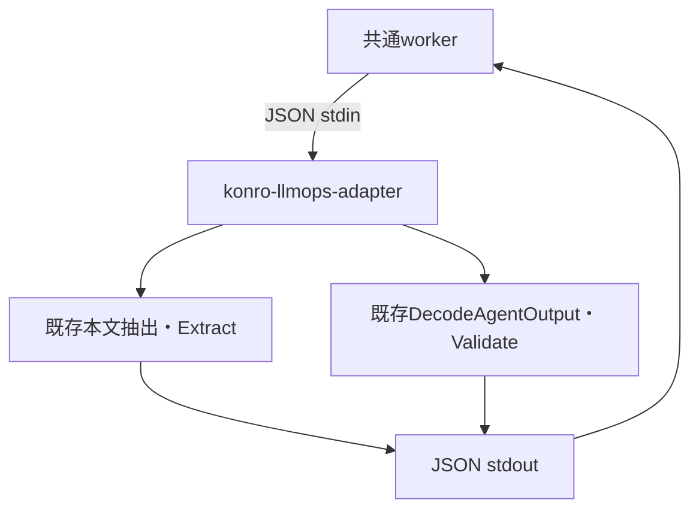

# Konro LLMOps adapter

保存済み原文の前処理と、明示注釈を使う出力評価を行うCLI。共通基盤はKonroのGo内部型をimportせず、versioned JSON protocolで接続する。URL取得・モデル呼出・下書き作成・正式保存は行わない。

## 接続と責任



共通envelopeは[LLMOps contracts](../../llmops/contracts/README.md)が正。domain schemaは`konro.recipe-import.v1`、protocol versionは`1`。一回の起動で一つのJSON requestをstdinから読み、一つのresponseをstdoutへ書いて終了する。全体は8 MiBまで、unknown fieldと末尾の別JSONを拒否する。request IDは1〜128文字の英数字・`_`・`-`で先頭は英数字。

不正envelope・ID・サイズ超過はresponseなしの非ゼロ終了。検査可能なrequestの未対応versionやdomain payload不正は、共通envelopeの`error`を返す。stdoutにログや入力原文を混ぜない。共通workerはoperatorのallowlistでbinaryを選び、ユーザー指定commandやshellを渡さない。

## prepare

payload:

```json
{"source_uri":"https://example.com/recipe","mime_type":"text/html","raw":"<h1>Captured recipe</h1>"}
```

| 項目 | 契約 |
|---|---|
| `source_uri` | 出典情報のみ。HTTP取得しない。HTML抽出では既存のサイト判定に使う。未指定なら既存Extractの手入力向けwarningを返す |
| `mime_type` | `text/html`、`text/plain`、`text/markdown` |
| `raw` | 空でないUTF-8。原文は既存MaxSourceの5 MiBまで |

HTMLは既存`sourceFromPage`と同じ本文抽出・サイト処理を使い、既存`Extract`で構造を取り出す。plain／Markdownは原文をprepared textへ渡し、構造化レシピを推測せず空のdraftとwarningを返す。plain／Markdownは128 KiB超を明示拒否する。HTMLの既存本文上限128 KiBは維持し、`text_truncated=true`を返す。

resultは`text`、`text_bytes`（切詰め後UTF-8 byte数）、`text_truncated`、`content`（既存title/servings/ingredients/steps）、`warnings`、`output_schema`（既存importer.Schema）。Raw保存・SHA-256・datasetの出自は共通workerの責務。

## grade

payload:

```json
{
  "output":{"title":"スープ","servings":"","ingredients":["玉ねぎ1/2個"],"steps":["煮る"]},
  "annotation_status":"confirmed",
  "expected":{"title":"スープ","servings":"","ingredients":["玉ねぎ1/2個"],"steps":["煮る"]}
}
```

`annotation_status`は`confirmed`／`unreviewed`。`output`は既存online適用と同じpure decoderを通し、既存`Validate`で保存可能な構造か調べる。title・servings・ingredients・stepsは必須、unknown fieldと主要4項目のnullを拒否する。既存online互換性のためassessmentは任意で許可し、既存の長さ検査を使う。LLMへ提示する既存output schemaと、onlineで受け入れてきたdecoderの必須項目は同一ではない。

| 状態 | 判定 |
|---|---|
| `failed` | 出力の形式・必須内容が不正、または確認済みexpectedとの不一致 |
| `needs_review` | 出力形式は有効だが注釈がunreviewed、またはexpectedがない |
| `passed` | 確認済みexpectedの全フィールドに完全一致 |

確認済みexpectedは保存可能なレシピであることを検査する。title・servingsは文字列完全一致、材料・工程は順序を含む文字列配列の完全一致。人数不明を`""`として注釈すれば、推測人数の追加を検出できる。数量の意味解釈や表記揺れの許容は行わないので、言い換えを許容するケースは人の確認が必要。合否を一般的なモデル精度や意味的一致の保証と扱わない。

resultは`status`、個別`checks`、順序固定の`reasons`を持つ。未確認の編集を正解へ昇格させない。prepared入力・モデル出力・注釈の採用権限はadapter外で管理する。

## 検証

backendで`go test ./...`。adapter試験は、出典URLのHTTP serverにアクセスしないこと、HTML由来材料の保持、切詰めの表示、plain超過、未確認注釈、推測人数の追加、材料欠落、不正field、envelopeへのshell指定、末尾JSONを検査する。既存importer試験も同じ実行で通す。
