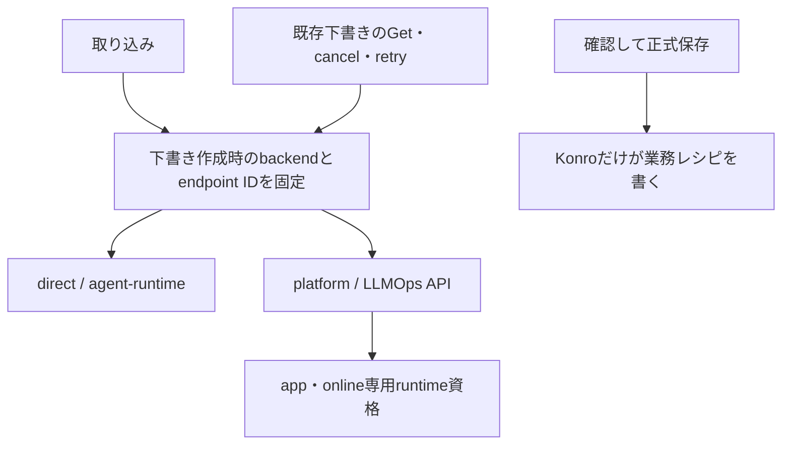

# 取り込みのLLMOps接続

取り込みだけを`direct`／`platform`で切り替える。既定はdirect。献立提案は既存agentclientの経路を使い続ける。

## 設定

| 設定 | 用途 |
|---|---|
| `KONRO_IMPORT_BACKEND` | direct（既定）／platform。取り込みの新しい下書きに適用 |
| 既存`KONRO_AGENT_*` | directのURL・service client・secret file・CA。旧下書きと献立も使用 |
| `KONRO_LLMOPS_URL` | Platform APIのbase URL。HTTPSまたはliteral loopback HTTP |
| `KONRO_LLMOPS_TOKEN_URL` | Platform向けKeycloakのHTTPS token endpoint |
| `KONRO_LLMOPS_CLIENT_ID`／`KONRO_LLMOPS_CLIENT_SECRET_FILE` | app専用の資格。secret値をGit・ブラウザへ渡さない |
| `KONRO_LLMOPS_CA_FILE` | 開発用CAの明示trust。tokenとAPI両方に適用 |
| `KONRO_IMPORT_RETAINED_FILE` | 過去endpointの接続設定を残す任意JSON配列。資格自体ではなくsecret fileのpathを持つ |

retained配列の各項目はkind、url、client_id、token_url、client_secret_file、ca_file。directのローカル資格にはtoken_fileも使用できる。unknown fieldを拒否し、最大32endpointに制限する。

下書きには`backend_kind`と`backend_endpoint`を保存し、job IDは既存`job.id`に保持する。endpoint IDはkind・base URL・client IDから作るhashで、URLやsecretそのものを下書きへ保存しない。secret値のrotationではIDが変わらず、URL／client IDが変わると別endpointになる。旧endpointのjobが残る間はretained設定と資格を維持する。同じIDのretained項目で現在設定を上書きしない。

backend項目のない旧下書きはLegacyDirectへだけ接続する。この移行前の下書きには過去URLの記録がないため、当時のdirect設定を維持して扱う。flag変更だけで旧jobをPlatformへ送らない。

## 失敗・復旧・切戻し

Platform Createは`kind=online`とし、既存JobKeyをIdempotency-Key headerへ対応付ける。job作成の応答を失っても、下書きのPending・JobKey・元backendを保持して同じ受付を照合する。失敗時にdirectへ自動fallbackしない。

元endpointの設定・資格がなくなった場合、GETは原文と下書きを返し、実行中jobはwaiting／backend_unavailableとして表示する。通信・認証失敗中も入力を失わず、手入力への切替が可能。元の資格を復旧して再起動すれば、同じbackend／jobへ照会する。

Platformのfailed retryは新しいjob IDを返せる。retry headerを元job IDから決定的に生成するため、応答喪失後に同じretryを送っても新attemptが重複しない。directでは従来どおりjob IDの変更を拒否する。

起動時にAI資格を読み込めない場合も、アプリは手入力用に起動できる。利用可能でないAI接続を有効と表示しない。flagをdirectへ戻しても、platformで作成済みの下書きには引き続きplatform資格が必要。設定なしのまま原文を正式レシピへ保存する場合は、明示的に手入力へ切り替えて内容を確認する。

## 確認

Konro backend全試験とimporter／clientのrace試験、frontendの型検査・buildに成功。flag切替後の元backend照会、旧下書きdirect、元資格なしの入力保持、復旧後の確認保存、失敗時fallbackなし、Platform failed retryの新IDと同じretry keyを確認した。

この段階はGatewayを使うアプリ側試験。実Platform API・Keycloak・S3を通す一周とブラウザ操作は統合試験段階で確認する。原文・feedbackのLake送信outboxは次のタスクで追加する。
