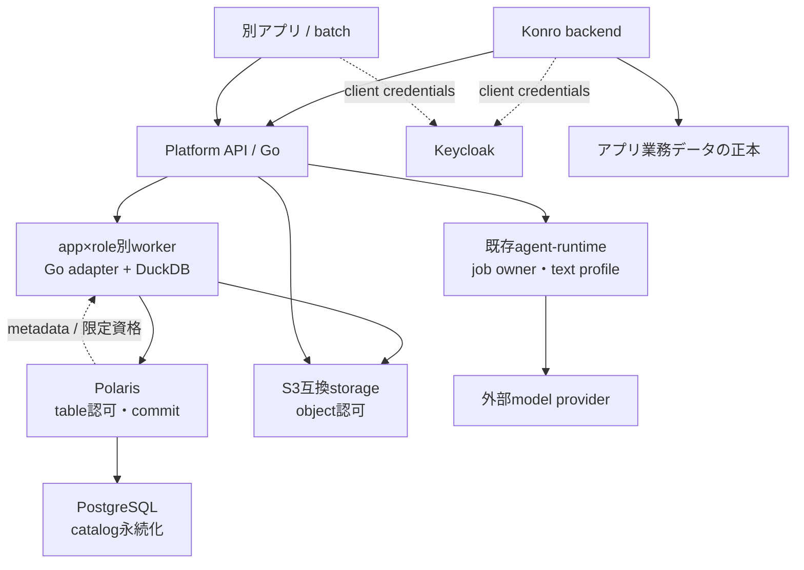
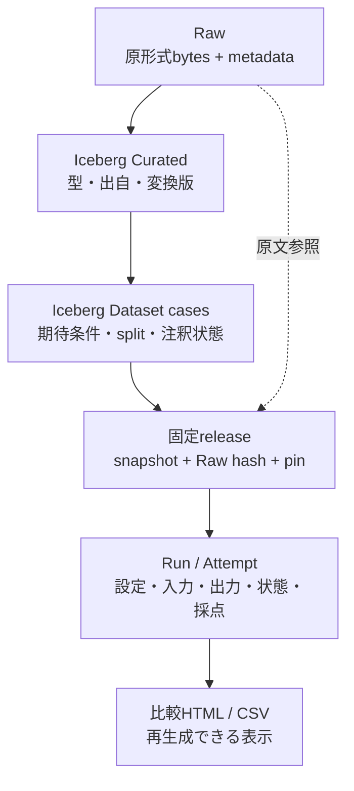
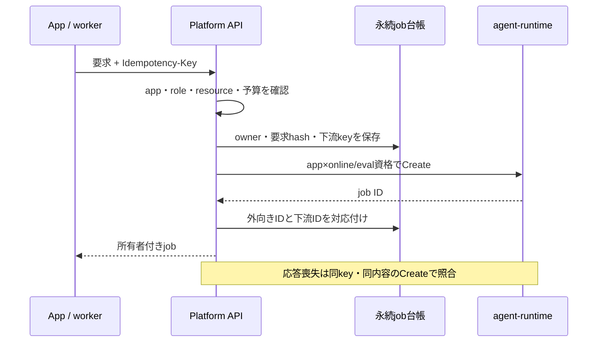

# 共通LLMOps V0のアーキテクチャ

アプリごとの資格でデータ・推論・評価を利用する共通基盤。最初はKonroの取り込みで一周し、別アプリのアクセスを拒否できることを確かめる。UIと業務の正本はアプリが所有し、基盤は出自・dataset版・推論run・評価の契約を共通化する。

## この差分の実装範囲

現在は**共通サービスとローカルデータ基盤を実装し、各境界を検証した段階**。V0全体は未完了。固定datasetの公開、評価runnerと実runの比較、outbox、backup復元と横断統合試験は後続となる。

| 境界 | 実装・検証済み | 残る接続・検証 |
|---|---|---|
| API | schema、capture/feedback、job/artifact HTTP API、起動CLI | 実サービスを通す全経路の統合 |
| identity/policy | JWT、鍵更新、固定mapping、app/role/owner認可、scope cursor | 横断分離試験 |
| job/runtime | 永続受付・quota・再照合・状態理由、OAuth client、実agentd OIDC契約試験 | 実モデルsmoke（未実施） |
| adapter/worker | Konro prepare/grade、登録binary hash、app/role固定worker | dataset/evalコマンドの一周 |
| catalog/S3 | TLS環境、限定資格、app別catalog、実snapshotと認可試験 | 長時間S3 session更新、backup復元 |
| grading/report | 未確認を分けるgrader、回帰比較HTMLとescape/狭幅検証 | 実runを読み込む評価runner |

各タスクの個別検証と基盤全体の完了を区別する。native adapterは信頼した登録binaryの実行境界であり、同UIDのファイル・ネットワークまで制限するOS sandboxではない。

再実行は[開発環境](../dev/README.md)、[権限bootstrap](../dev/bootstrap/README.md)、[互換性probe](../dev/probes/README.md)、[job API](../internal/api/JOBS.md)を参照する。

## サービスの境界

線は主な呼出、点線は認証・metadataの関係。応答は同経路を戻る。runtimeは既存の別プロセス、providerは外部。PolarisはSQL計算やデータ転送を行わず、DuckDBが認可されたS3資格で実データへアクセスする。

| 構成 | 責務 |
|---|---|
| 各アプリ | UI、利用者の業務権限、原文取得、正式保存、domain schema |
| Platform API | identity mapping、操作／resource認可、capture・job・feedback、artifact取得、app別受付予算 |
| app×role別workers | 加工・dataset公開・評価・SQL集計。共通codeを限定資格で実行 |
| Polaris＋PostgreSQL | namespace／table／commitの認可とcatalog永続化 |
| S3＋Iceberg | Raw・artifact、Parquet・table metadata・snapshot |
| agent-runtime | 推論job、provider資格、既存共有利用枠 |

## 認証と認可

Keycloakは主体を確認し、権限は操作を受けるサービスが強制する。各入口で署名・issuer・audience・期限を検証する。API向けtokenをPolarisやruntimeへそのまま転送しない。verified clientからapp／roleを解決し、bodyや任意headerでowner・prefix・下流資格を選ばせない。

V0はサービス主体のClient Credentials。アプリ利用者の業務権限はアプリが確認し、actor user情報は監査用。本人委譲と人間向けReview UIは後段。

| 役割 | API | table／object |
|---|---|---|
| app | 自app online job、Raw／feedback受付 | 直接資格なし |
| transform | 必要な自app capture参照 | Raw読取、Curated／Datasets・release更新 |
| eval | 自app eval job・許可artifact | dataset／必要Raw読取、run／report書込。正解・release manifestは更新不可 |
| sample app | 自app試験操作 | 別namespace・prefixに限定 |

作成だけでなく一覧・取得・取消・retry・artifact取得にも認可する。他appのresourceは404、許可されない操作は403。cursorにも認可範囲を適用する。

namespace名だけでは隔離にならずPolaris grantsが必要。S3はRawやrunも守り、共通rootキーをworkerへ渡さない。app別prefixとtable別locationを使い、WHERE app_idだけで全appを1表に混ぜない。共通APIは複数appの資格を扱う信頼境界なので、資格選択の取り違えを否定試験する。

## データ層と再現性

Rawは元のbytes、metadata・release・runはJSON、table実体はParquetを使う。原文HTMLと閲覧HTMLは別の意味を持つ。Icebergは表の履歴、Polarisはcatalog、S3は実体、DuckDBは計算を担当する。

初版の構成はapp別catalog `konro`と`sample`、その中の`curated`／`datasets` namespace。共有Polarisサービスの中でもcatalog grantsとstorage prefixを分ける。Konroの対象は`konro.curated.recipes`と`konro.datasets.import_cases`の2表。料理schemaはKonro adapterが所有し、共通recordはobject参照・source group・domain schema／transform版だけを共通化する。

releaseは参照する全tableのsnapshot ID、Raw object／hash、case一覧hash、code／adapter版を固定する。複数tableの原子commitを仮定せず、参照検査とpin後に最後のimmutable manifestを公開する。未公開・改変・欠損releaseを拒否し、latestやglobで入力を選ばない。

snapshot IDだけではexpirationを防げない。tagと保持方針を併用し、一般runの保持期間と参照中artifactのpinを分ける。削除要求で原文を消す場合は派生releaseを無効化し、再現不能を記録する。

## 推論と再開

台帳はファイル、単一writer、排他lock。永続受付後に下流へ送る。同key・同内容の通信再送は同job、異内容は409。waiting retryは同attempt再開、failed／interruptedは明示操作で新attempt・新keyを作る。S3再送でLLMを再実行しない。

runtimeはtext profile・owner別job制御・冪等POSTを利用する。モデル・usageの未取得はnull。既存global FIFOと共有枠はapp別優先保証ではない。V0の予算・online優先はAPI未送信範囲で制御し、送信済みjobや既存直結consumerの順序を変えない。

API／workerが所有権を検査した入力だけを渡す。任意S3 URIの代理取得をruntimeへ頼まず、provider資格はruntime側だけが持つ。

## Adapterとアプリ接続

workerはallowlist済みbinaryへJSONをstdinで渡しstdoutを検証する。Konro module内のbinaryが既存importerの純粋な抽出・検証を再利用し、Go internal境界を跨がない。adapterは保存・ネットワーク取得・推論を行わない。

KonroのGatewayへplatform clientを差し込み、起動設定でdirect／platformを選ぶ。jobは作成時backendとendpoint識別子を保持し、flag変更で別backendへ照会しない。自動direct fallbackは二重推論になり得るため行わない。Raw／feedbackのoutboxは再送を扱い、正式保存はKonroだけが行う。

## 評価から採用まで

同release・evaluatorで現行／候補promptを比較する。schema適合に加え、注釈による保持・欠落・不明を評価し、未確定はneeds_reviewにする。合成fixtureと実利用原文を区別し、通常編集をgoldへ自動昇格しない。

比較HTMLはcase別出力、回帰・改善・未確認、失敗・待機、snapshot／run／code版、usage不明を表示する。未完了を分母から消さず、原文・生成文のHTMLをescapeする。採用は人がGit管理のprompt／profile設定を変更し、旧版へ戻せるようにする。自動採用と追加学習は後段。

## 検証と配備

contract試験に加え、実Keycloak／Polaris／S3で自app成功・別app拒否・eval書込拒否・snapshot再読込を確認する。復元ではcatalog、S3、API owner／job対応台帳、runtime台帳との再照合まで扱う。fixture試験・実サービスintegration・実モデルsmokeを分け、未実施を隠さない。

ローカル環境は本番realm・bucket・volumeと分離。OIDC issuerはhost／containerから同じHTTPS URLで到達しlocal CAを明示trustする。TLS検証を無効化せず、共通LocalTokenで複数owner分離を実証したことにしない。

配備例はArgo監視対象外のapps/llmops/deployに置き、draft PRで本番Application・Secret・DNS・routeを有効化しない。

外向き形式と上限は[contracts](../contracts/README.md)、[OpenAPI](../contracts/openapi.json)、[record schemas](../contracts/schemas/)を参照する。

Konro固有のpayload・実行例・採点条件は[adapter契約](../../konro/docs/llmops-adapter.md)を参照。

## Konro取り込みの接続境界

Konroの取り込みは下書き作成時にdirect／platformとendpoint IDを固定する。起動flagを変更しても、既存jobの照会・取消・再開は保存済みbackendへ送る。元資格がない場合は待機と入力保持を優先し、別backendへ自動fallbackしない。献立の推論経路は既存directのまま。詳しい設定・切戻しは[Konro接続契約](../../konro/docs/llmops-platform.md)を参照。原文・feedbackのoutboxは後続実装。
